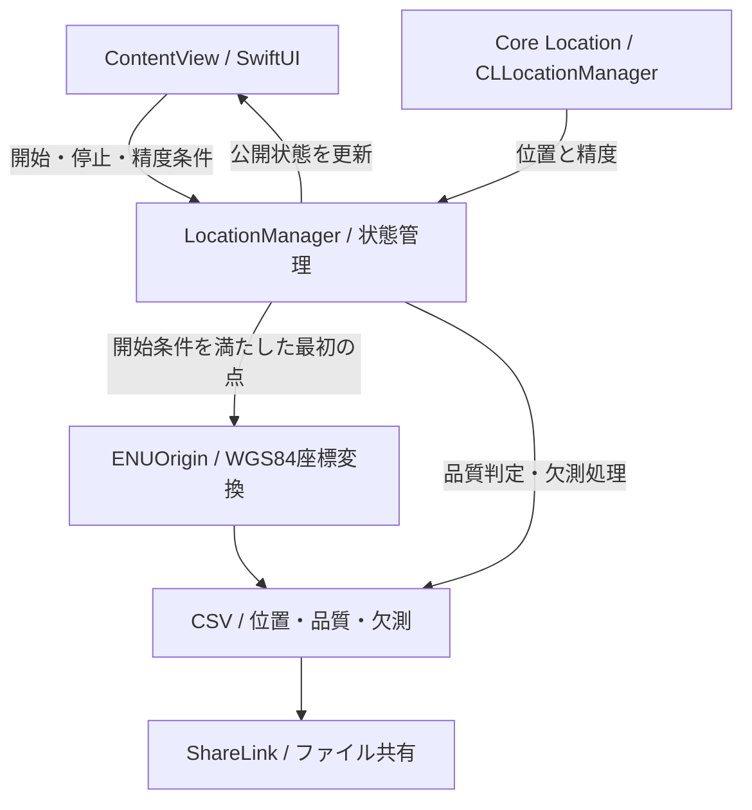

# GNSSPositioning

[ARKit・IMU計測アプリに戻る](../README.md)

iPhoneのCore Locationを利用し, 現在位置と測位品質を表示・CSV記録・共有するSwiftUIアプリです.

## 動作環境

- Xcode 26.3以降
- iOS 17.0以降
- 実機での測位を推奨

## 実行方法

1. `GNSSPositioning.xcodeproj` をXcodeで開きます.
2. Signing & Capabilitiesで自分のTeamを選択します.
3. iPhoneを実行先に選び, Runします.
4. 初回表示時に「測位・記録を開始」を押し, 位置情報の利用を許可します.

## CSV記録と送信

1. 水平精度の開始条件（5 / 10 / 20 / 50 m）を選びます. 初期値は10 mです.
2. 「測位・記録を開始」を押します. 条件を満たすまでは「精度待機中」となり, CSVには記録しません.
3. 条件を満たした最初の測位点をENU座標の原点としてCSV記録を開始します.
4. 「測位・記録を停止」を押してファイルを確定します.
5. 「CSVを送信・保存」からAirDrop, メール, メッセージ, ファイルアプリなどへ共有できます.

CSVはアプリのDocumentsディレクトリへ保存され, アプリを再起動しても最後のファイルを共有できます. `Timestamp`はUnixエポックからの秒数を, `SystemUptime`は端末起動からの秒数を, それぞれ小数6桁で記録します. `SystemUptime`はARKitの`ARFrame.timestamp`と時間軸を合わせるための列です.

```text
Timestamp,SystemUptime,Latitude,Longitude,Altitude,EllipsoidalAltitude,East,North,Up,OriginLatitude,OriginLongitude,OriginEllipsoidalAltitude,RequiredHorizontalAccuracy,ExpectedInterval,HorizontalAccuracy,VerticalAccuracy,Speed,SpeedAccuracy,Course,CourseAccuracy,QualityFlags
1785722340.062214,123456.789012,35.681236000,139.767125000,12.345,51.234,0.000,0.000,0.000,35.681236000,139.767125000,51.234,10.000,1.000,4.500,7.200,0.120,0.300,91.000,5.000,OK
```

単位は高度・ENU座標・精度がメートル, 速度がm/s, 進行方向が度です. `East`, `North`, `Up`は最初に開始精度を満たした点を原点とするWGS84ローカルENU座標です.

## 品質フラグと欠測

`QualityFlags`には, セミコロン区切りで次のような値が入ります.

- `OK`: 設定した品質条件を満たしています.
- `LOW_HORIZONTAL_ACCURACY`: 水平精度が記録開始条件より悪化しています.
- `LOW_VERTICAL_ACCURACY`: 垂直精度が低下しています.
- `MISSING_SPEED` / `MISSING_COURSE`: 速度または進行方向を取得できていません.
- `LOW_SPEED_ACCURACY` / `LOW_COURSE_ACCURACY`: 速度または進行方向の精度が低下しています.
- `MISSING_LOCATION`: 約1 Hzを基準に位置更新が欠けています.

`MISSING_LOCATION`行では座標を補間せず空欄にします. 連続するGNSS点の間隔から`ExpectedInterval`（現在は1秒）を基準に欠落数を推定し, Timestamp, SystemUptime, ENU原点, 判定条件だけを記録します. 後処理では`QualityFlags`を使って明示的に除外できます.

シミュレータでは, Xcodeの `Features > Location` からテスト位置を指定できます.

## iOSにおけるGNSSについて

Core Locationが返す位置は, GNSSだけでなくWi-Fi, 携帯基地局, Bluetooth, 端末センサーなどを統合した結果です. 標準APIから, 使用衛星, 衛星数, NMEAセンテンスなどの生GNSS情報を直接取得することはできません.


## 開発目的・システム構成

位置推定の研究で利用する位置情報と測位品質を収集するためのiOSアプリです. 取得処理に加えて, 記録開始条件, 座標変換, 品質フラグ, 欠測行の生成, CSV共有を実装しています. 測位計算自体はCore Locationを利用しています.



`ContentView`は表示と操作を担当し, `LocationManager`は権限, 測位状態, 記録開始条件, CSV保存を管理します. `ENUOrigin`は緯度・経度・楕円体高を地球中心の三次元座標へ変換した後, 最初の記録点を原点とする東・北・上方向の座標を算出します.

## 設計上の工夫

記録開始時に水平精度の条件を設けることで, 精度が不十分な初期位置を原点にすることを避けています. 記録開始後に精度が低下した点は除去せず, 品質フラグを付けて後処理で判別できるようにしています.

位置更新の欠落は座標で補間せず, 空欄と`MISSING_LOCATION`を記録します. 期待更新間隔の1秒は欠測判定の基準であり, Core Locationが常に1 Hzで更新することを保証する設定ではありません.

Unix時刻に加えて, コールバック受信時の壁時計とuptimeから換算した端末起動後時刻を記録します. 同一端末で取得したARKit時刻との比較を支援する情報であり, 別端末間の同期精度を保証する仕組みではありません.

## 構成ファイル

| ファイル | 役割 |
|---|---|
| `GNSSPositioningApp.swift` | SwiftUIアプリのエントリポイント |
| `ContentView.swift` | 測位状態・位置・精度・記録状態の表示と共有操作 |
| `LocationManager.swift` | Core Locationの権限・受信処理, CSV記録, 品質判定, ENU変換 |

## ビルド確認

```sh
xcodebuild -project GNSSPositioning.xcodeproj -scheme GNSSPositioning \
  -destination 'generic/platform=iOS' CODE_SIGNING_ALLOWED=NO build
```

実機へのインストール時は自分のTeamを指定してください. ビルド生成物, 個人設定, 実際の移動履歴は含めていません. 
屋外での測位品質や端末間の時刻比較は実機で評価する必要があります.

## English overview

SwiftUI location logger using Apple's Core Location. It records coordinates, altitude, speed, course and accuracy metadata; gates recording on a configurable horizontal-accuracy threshold; converts coordinates to local WGS84 ENU; marks quality degradation and estimated missing updates; and shares CSV files with ShareLink.

Core Location provides a fused location estimate rather than raw GNSS observations. A one-second expected interval is used for missing-update annotation, not as a guaranteed sensor sampling rate.

## Author

Haruto Ike
