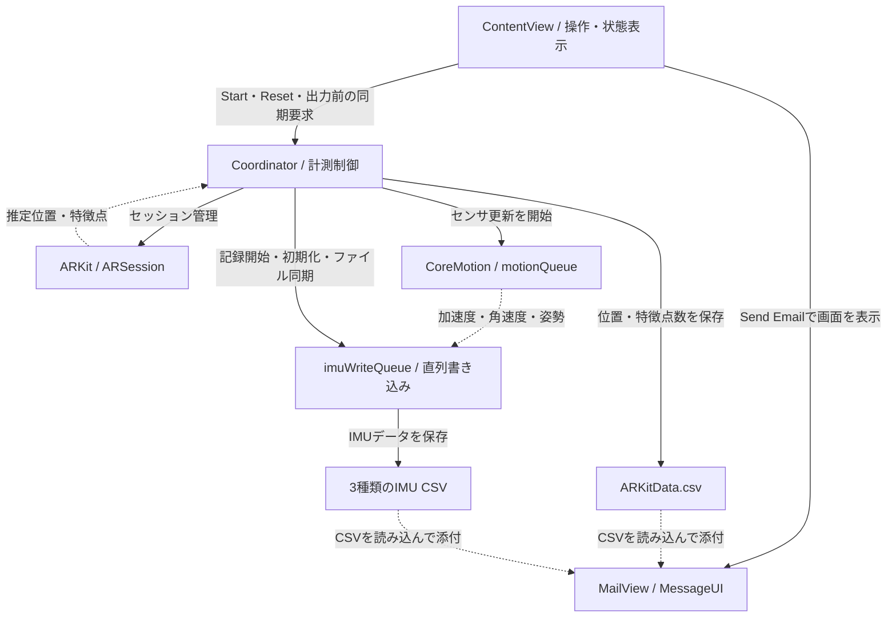

# ARKit VIO Evaluation — ARKit・IMU計測アプリ

モバイルARの位置推定誤差を分析するための研究用iOSアプリです．車内実験で使用した `car` の最終利用版を基に，公開用の設定とドキュメントを整備しています．

ARKitによる開始位置からの変位・特徴点数と，CoreMotionによる生加速度・生角速度・姿勢をCSVへ記録します．位置推定と慣性情報を別々の時系列として取得できるため，視覚・慣性情報の不整合を調べる実験に利用できます．

## 関連する開発成果物

[GNSSPositioning：GPS・位置情報の記録アプリ](GNSSPositioning/)も独立したXcodeプロジェクトとして公開しています．測位精度の判定，WGS84ローカル座標変換，品質フラグ，欠測処理，CSV共有を備えています．各プロジェクトは単独でビルドできます．

## 開発の目的と範囲

研究で必要な位置・慣性情報を継続的に収集し，実験後の分析へ渡す計測アプリとして開発しました．公開する成果物には，計測開始・リセット・状態表示，特徴点の可視化，CSV記録，メールへの添付を含みます．位置推定はAppleのARKit，慣性データ取得はCoreMotionを利用しています．本アプリは，研究で検討中の過去状態修復手法そのものを実装したソフトウェアではありません．

## 主な機能

- ARKitの追跡状態・マッピング状態・特徴点数による初期化判定
- 開始位置を原点とした三次元変位と，原点からの直線距離の記録
- 特徴点数の表示と，カメラ映像への特徴点オーバーレイ
- 生加速度，生角速度，DeviceMotionの重力・ユーザー加速度・姿勢の独立記録
- CoreMotionの更新間隔を100 Hz相当に設定（実際の取得周期は端末・OS・負荷に依存）
- 書き込み専用の直列キューとファイルハンドルによるIMUログ保存
- 4種類のCSVをメール作成画面へ添付

## システム構成

操作の入口である`ContentView`を上段に置き，計測・保存とメール画面の表示を分けて示します．実線は操作・制御，破線はデータの受け渡しを表します．



`ContentView`がStart・Reset・Send Emailの操作を受け付けます．計測処理は`ARKitARViewContainer.Coordinator`へ渡し，Send EmailではIMUファイルの同期を要求した後，SwiftUIのsheetで`MailView`を表示します．メール画面はCSV保存後に自動表示される構成ではありません．

`Coordinator`はARSessionのイベントと計測状態を管理し，ARKitData.csvへの記録と特徴点オーバーレイの描画を担当します．追跡状態や特徴点数はBinding・通知を通じて`ContentView`へ反映します．図では操作の入口を明確にするため，状態表示へのフィードバック矢印を省略しています．

CoreMotionのコールバックは専用のOperationQueueで受信します．IMUファイル操作は直列キューへ集約し，複数のセンサからの書き込みを順序付けています．`MailView`は同期要求後の4種類のCSVを読み込んでメールへ添付し，利用者が宛先と送信を確定します．

## 使用技術・動作条件

| 項目 | 内容 |
|---|---|
| 言語・UI | Swift，SwiftUI，UIKit |
| 位置推定・描画 | ARKit，SceneKit，CAShapeLayer |
| 慣性センサ | CoreMotion |
| データ保存・共有 | Foundation，CSV，MessageUI |
| 対象 | iOS 17以降のARKit対応実機 |
| ビルド確認環境 | Xcode 26.3 |
| 外部パッケージ | なし（現行コードで未使用のKronos依存設定は公開時に削除） |

## 導入方法

1. `ARKitQR.xcodeproj` をXcodeで開きます．
2. Signing & Capabilitiesで自分のTeamと適切なBundle Identifierを設定します．
3. ARKit対応のiPhoneを選択してビルド・実行します．
4. カメラとモーションの利用を許可します．メール出力には端末のメール設定が必要です．

```sh
xcodebuild -project ARKitQR.xcodeproj -scheme ARKitQR \
  -destination 'generic/platform=iOS' CODE_SIGNING_ALLOWED=NO build
```

## 使用方法

1. アプリ起動後，周囲を撮影して初期化します．追跡が正常，マッピングがextendingまたはmapped，特徴点50点以上の状態が2秒続くとStartが有効になります．
2. **Start**を押すと，その時点の推定位置を原点としてARKit・IMUの記録を開始します．
3. 必要に応じてトグルで特徴点を可視化します．
4. **Send Email**を押すと，その時点のCSVを添付したメール作成画面が開きます．宛先は作成画面で指定します．
5. **Reset**でCSVと原点を初期化します．必要なCSVを先に出力してください．

メールの送信は利用者が作成画面で確定します．現行版には210秒後の自動メール表示や専用の停止ボタンはありません．メール作成画面を開く操作は記録停止操作ではないため，添付ファイルは書き出した時点のデータです．

## 記録データ

| ファイル | 内容・単位 |
|---|---|
| `ARKitData.csv` | Unix時刻，原点からの距離とX/Y/Z変位[m]，最新のDeviceMotionユーザー加速度[m/s²]，特徴点数 |
| `RawAccelerometer.csv` | センサ時刻，Unix時刻，重力を含む生加速度[g / m/s²] |
| `RawGyroscope.csv` | センサ時刻，Unix時刻，生角速度[rad/s] |
| `DeviceMotion.csv` | センサ時刻，Unix時刻，重力[g]，ユーザー加速度[g / m/s²]，角速度[rad/s]，クォータニオン，roll/pitch/yaw[rad]，姿勢参照系 |

`Distance`は原点からのユークリッド距離であり，移動経路の累積長ではありません．ARKitDataの加速度はARフレーム受信時点の最新値であり，IMUとの厳密な同時サンプリングを意味しません．現在のCSVには個別特徴点の座標・識別子を出力せず，特徴点数を記録します．

### 時刻と座標系

起動時のローカルUnix時刻とsystem uptimeの差をオフセットとして，ARKit・CoreMotionの時刻をUnix時刻へ変換します．ネットワーク時刻同期や別端末間のハードウェア同期は行いません．IMU CSVには元のSensorTimestampも残します．

位置はARKitのローカル座標系です．GPS座標への変換機能はありません．DeviceMotionの姿勢参照系は`xArbitraryZVertical`であり，地理的な北を基準とする姿勢ではありません．

## 公開版の整備内容と検証

最終利用版からの公開用変更は，メール宛先の固定値の削除，開発者Team設定の解除，未使用のKronos依存設定の削除，共有スキームの追加，ドキュメントと除外設定の整備です．計測アルゴリズムとCSV形式は維持しています．

Xcode 26.3で署名なしのgeneric iOS向けビルドに成功しました（2026年11月27日）．実機センサの取得周期，長時間記録時の挙動，メール添付中の動作は，利用環境での確認が必要です．実験データ，ビルド生成物，Xcodeの個人設定は公開対象に含めていません．

## English overview

Research-oriented iOS data logger for evaluating ARKit visual–inertial odometry in vehicle environments. The final experiment version records local ARKit displacement and feature count alongside raw accelerometer, raw gyroscope and DeviceMotion streams configured at 100 Hz. It provides feature overlays and email-based export of four CSV files.

Built with Swift, SwiftUI, ARKit, SceneKit, CoreMotion and MessageUI. Timestamps use the local wall-clock/uptime offset; they do not provide cross-device hardware synchronization. Position estimation is supplied by ARKit. This repository contains the measurement application, not the proposed historical-state repair algorithm.

## Author

Haruto Ike
